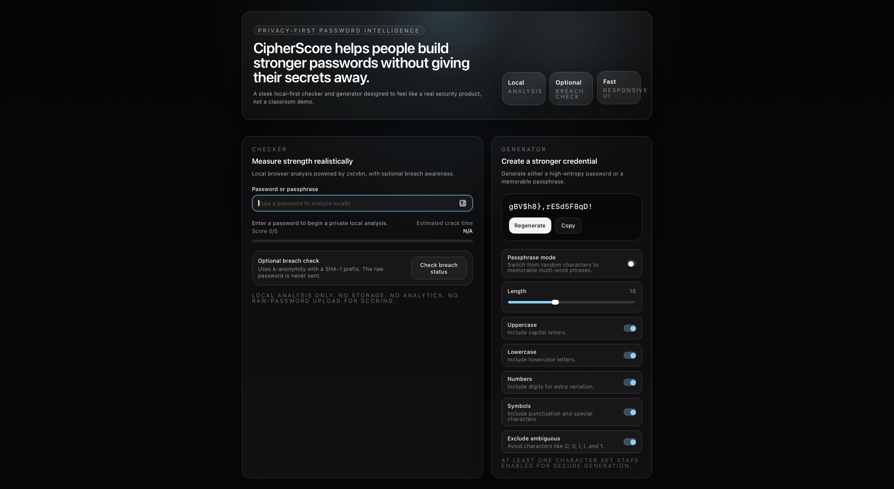
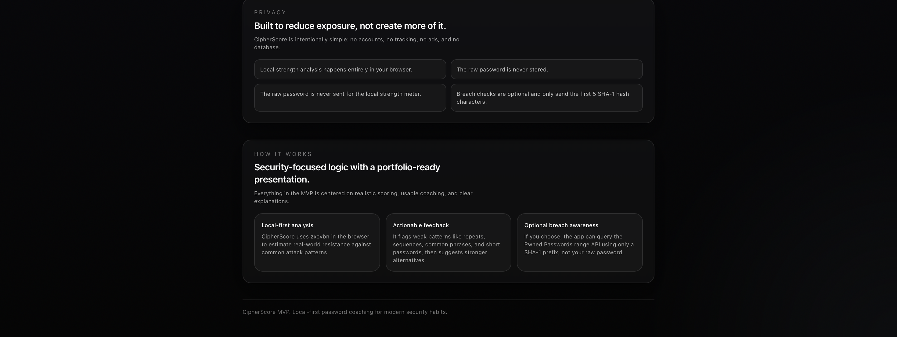

# CipherScore

CipherScore is a privacy-first password checker and generator built with Next.js, TypeScript and Tailwind CSS. It estimates how guessable a password is with [zxcvbn-ts](https://github.com/zxcvbn-ts/zxcvbn), generates passwords and multiword passphrases with the browser's cryptographically secure random number generator, and offers an optional breached-password lookup that sends only a 5-character hash prefix. There are no accounts, no database, no analytics and no password storage.

## Screenshots

> **These two screenshots show the previous (v0.1) interface** and have not been refreshed. The current UI replaced the 1-to-5 score and "estimated crack time" with a zxcvbn 0 to 4 score and a guess count, and added the passphrase options, the accessible error messages and the entropy line.




## Features

Everything here is **implemented**. The next section says which security properties have actually been **verified**, and how.

**Generator**

- Random passwords, 8 to 128 characters (default 20), from lowercase, uppercase, digits and symbols, individually switchable.
- "Avoid look-alike characters" (`O 0 I l 1 |`) and "Include every selected type" options.
- Multiword passphrases of 4 to 12 words (default 6) from the [EFF Large Wordlist](https://www.eff.org/dice) (7,776 words, about 12.9 bits per word), with a choice of separator, optional capitalization and an optional appended number (0 to 99).
- A live entropy figure for the *generation process* (see [Technical decisions](#technical-decisions)).
- Copy to clipboard with a fallback that selects the text if the browser blocks clipboard access; hide/show of the generated value.
- Configuration errors (length out of range, no character type selected, no secure randomness available) are shown in an `role="alert"` message and tied to the offending control with `aria-invalid` / `aria-describedby`; nothing is generated from an invalid configuration.

**Checker**

- Local strength estimate from zxcvbn-ts, shown as a 0 to 4 score, a label, and the estimated number of guesses (as a power of ten), with zxcvbn's own warnings and suggestions.
- A reminder when a password is shorter than the 15 characters NIST SP 800-63B-4 sets for single-factor passwords.
- Show/hide toggle; paste is allowed.
- Optional breach check against Have I Been Pwned's Pwned Passwords range API using k-anonymity. Nothing is requested until the button is pressed; an edit cancels an in-flight check and discards a late answer.

**Interface**

- Native form controls (checkbox switches, radio group, range and number inputs, select) with labels, visible focus rings, a responsive layout (checked at 375 px and 1280 px) and `prefers-reduced-motion` support.

## Security properties: implemented vs. verified

"Automated" means a test in `tests/` (`npm test`). "Browser" means I checked it by hand in a running production build (Chromium-based pane, one session). Statistical and source-scan tests can show a bug is *absent from what they exercise*; they are not proofs.

| Property | How it is implemented | What has actually been verified | Not verified |
|---|---|---|---|
| Secure randomness | Every choice goes through one function, `randomInt` in `lib/secure-random.ts`, which calls `crypto.getRandomValues` and throws if Web Crypto is missing (no `Math.random` fallback). | Automated: the Web Crypto call is observed; `Math.random` is rigged to throw and is never reached; generation fails closed with no `crypto`; a source scan finds `getRandomValues` called in exactly one module. I injected three bugs (plain modulo, `Math.random`, silent fallback) and the suite failed each time. | The quality of the browser/OS CSPRNG itself is assumed. |
| No selection bias | Rejection sampling: draws at or above the largest multiple of the range that fits in 32 bits are discarded. Whole passwords are redrawn until every selected type appears, which is uniform over all valid passwords (the old pick-one-per-type-then-shuffle approach was not). | Automated: exact accept/reject boundary for 16 range sizes including 7,776 and the worst case 2^31+1; chi-square uniformity on characters, words and positions. | Uniformity is not proven, only tested statistically. |
| Output matches settings | Options are validated before any randomness is used. | Automated: exact length for every length from 8 to 128; only allowed characters for all 15 type combinations x 2 x 2 flags; look-alikes excluded; required types present; invalid and edge configurations rejected. | |
| Wordlist integrity | The EFF list is stored as an array in `lib/wordlists/eff-large.ts`. | Automated: 7,776 unique, well-formed words, frozen; the original EFF file is rebuilt from the array and its SHA-256 matches the hash of the file I downloaded (`addd3553...b903e`). | That the downloaded file equals what EFF currently publishes (no independent hash was available). |
| Entropy figures | Computed exactly (`lib/entropy.ts`), including the effect of "include every selected type". | Automated: inclusion-exclusion count checked against brute-force enumeration on small cases. | |
| Password not sent | Analysis and generation are local. The only request that involves the password is the opt-in breach check, which sends the first 5 hex characters of its SHA-1 to `/api/breach-check`. | Automated: `fetch`, `XMLHttpRequest` and `sendBeacon` are watched while typing, generating and copying: nothing is sent; the breach check sends exactly `?prefix=XXXXX` and no body or headers, and neither the password nor the hash suffix appears in anything sent. Browser: the network log of a session (typing, generating, one breach check) shows one API request, `prefix=CBFDA`. | Behaviour of browser extensions, or a compromised device. |
| Not stored | No storage API is used. | Automated: storage writes, `document.cookie` and URL changes are watched; a source scan forbids `localStorage`, `sessionStorage`, `indexedDB` and cookie APIs. Browser: after the session, localStorage, sessionStorage, cookies, IndexedDB, CacheStorage and service workers were all empty. | Browser memory, swap, crash dumps, or the clipboard (which keeps the copied password until overwritten). |
| Not logged | No `console` calls anywhere; the API route logs nothing. | Automated: console methods are spied on in every component and route test (React warnings would also fail them); a source scan forbids `console.`. Browser: the console was empty. | Logs outside the app: a host, reverse proxy or CDN will typically log the request URL, i.e. the 5-character prefix and the client IP, for the breach check. |
| No analytics | None are included. | Automated: no analytics/telemetry package among the 6 runtime dependencies; a source scan forbids common tracker names. | |
| Egress restricted | `Content-Security-Policy` with `connect-src 'self'`, `img-src 'self' data: blob:`, `frame-ancestors 'none'`, plus `Referrer-Policy: no-referrer`, `nosniff` and others. | Automated: header contents, with `unsafe-eval` and websockets only in development. Browser: from the page, `fetch`, a WebSocket and an image request to another origin were blocked with `connect-src` / `img-src` violations; a `sendBeacon` to another origin was reported as queued but a `connect-src` violation was recorded for it. | The policy keeps `script-src 'unsafe-inline'` (see Limitations). |
| Accessible | See Features. | Browser: a contrast audit of 76 text elements (enabled ones all >= 7.28:1; one disabled button, which WCAG exempts, was lower); Space toggles a switch, End moves a slider; no horizontal scroll at 375 px. Automated: roles, names, `aria-invalid`, alerts and status messages are asserted. | No screen reader was used. The contrast audit is my own script and ignores background gradients; **no axe/Lighthouse run**. Arrow-key radio navigation was not exercised in a browser. |
| Copy | See Features. | Automated: success and failure paths against a stubbed clipboard. Browser: the failure path (the test pane denies clipboard access), including that the password ends up selected. | **The success path in a real browser was not observed.** |

## Technical decisions

**Randomness and bias.** The original code did `crypto.getRandomValues(...)[0] % max`. The source was already a CSPRNG, but the modulo makes some outcomes slightly more likely: I computed a relative bias of at most about 2 x 10^-8 for the alphabet sizes involved, which is negligible in practice but is exactly the kind of flaw that should not exist in a generator. Rejection sampling removes it.

**The old passphrase generator was weak.** It drew from 20 words (about 23.8 bits for 4 words plus a 2-digit number, 14.4 million possibilities). It now uses the 7,776-word EFF list: 6 words is about 77.5 bits, and each added word adds about 12.9 bits. Capitalization adds no entropy and is not counted.

**Another original bug.** With "exclude ambiguous" off, `O 0 I l 1` were added to the pool even when uppercase or digits were disabled (a lowercase-only password could contain `0 1 I O`). A regression test covers it. Out-of-range lengths also used to return empty strings or silently drop the "one of each type" guarantee.

**What the entropy figure means.** It is `log2(number of equally likely outputs)` for how *this app* generated the value, assuming an attacker knows the settings. It is not an estimate for a human-chosen password (that is what the checker is for) and it says nothing about how a website hashes and stores the password.

**Strength estimation.** I replaced the original `zxcvbn` 4.4.2 (last released in 2017) with `@zxcvbn-ts`, the maintained TypeScript successor that [OWASP's Authentication Cheat Sheet](https://cheatsheetseries.owasp.org/cheatsheets/Authentication_Cheat_Sheet.html) points to. zxcvbn models an attacker (common passwords, words, names, keyboard walks, repeats, sequences, dates, l33t substitutions) and returns a guess estimate; the 0 to 4 score buckets it at 10^3, 10^6, 10^8 and 10^10 guesses. Consequences I chose deliberately:

- **No "time to crack" is shown**, because it depends on an attacker's hardware and on how the site hashes passwords, neither of which a web page can know. The original showed one and displayed the 0 to 4 score as "1/5".
- Labels describe guessability ("Hard to guess"), not security ("Excellent").
- Fuzzy (Levenshtein) matching is off and analysis covers the first 100 characters: with them on, a single estimate took 0.2 to 0.7 s for short inputs and over a second at 256 characters on my machine, which froze the page. The UI also waits 250 ms after typing stops. Pathological repetitive input at the cap can still take about 0.4 to 0.6 s.
- The estimator is loaded on demand, so its dictionaries ship as separate chunks instead of being part of the first page load. (Next.js 16 no longer prints bundle sizes in the build output, so the earlier "36 kB page, 123 kB first load" figures from Next 14 have not been re-measured.)
- The result object returned to the UI is a copy that drops zxcvbn's `password` and matched-substring fields.

**NIST SP 800-63B-4 (final, 31 July 2025) and OWASP.** Followed where they apply to a tool like this: the 15-character single-factor / 8-character multi-factor minimums drive the default length (20) and the warning; no password rotation advice; paste and a show-password option are allowed; at least 64 characters are accepted (the generator goes to 128); a breached-password check is offered; a strength meter is included. NIST tells *verifiers* not to impose composition rules. A generator is a different case, so the character-type switches exist only for compatibility with sites that still demand them, and the UI says length matters more than complexity.

**Breach check.** The browser computes SHA-1 locally and calls this app's `/api/breach-check?prefix=XXXXX`, which forwards to `api.pwnedpasswords.com/range/XXXXX` with `Add-Padding: true` (the response is padded to 800 to 1,000 rows, padding rows have a count of 0 and are ignored by the matcher). The 35-character suffix never leaves the browser. SHA-1 is used only because the API defines it. The route validates the prefix strictly, forwards no cookies or headers, sets `Cache-Control: no-store`, times out after 8 s, and logs nothing. The Pwned Passwords API needs no key and has no attribution requirement; attribution is welcomed.

**Dependencies.** Runtime: Next 16 (Turbopack for dev and build), React 19, and three `@zxcvbn-ts` packages (replacing one `zxcvbn`). Dev only: Vitest 4, jsdom, Testing Library. Versions are pinned, except `next`, which uses a caret range. Vitest 4.1.12 is the release `npm audit` points to for its test-runner advisories and still supports Node 20; jsdom stays on 26 because the newest jsdom needs Node 22+, and the project was developed on Node 20.

## Limitations

- **A web page cannot protect secrets from its environment.** Browser extensions, malware, a compromised device, shoulder surfing and screen recording are out of scope. JavaScript strings cannot be wiped, so the typed or generated value stays in memory until it is garbage collected, and a copied password stays on the clipboard until you replace it (the app does not try to clear it).
- **The breach check reveals more than nothing.** The 5-character prefix goes to whoever hosts this app (with your IP address, if their logs keep it) and then to Have I Been Pwned. Padding and k-anonymity limit what that reveals; they do not make it zero. "Not found" does not mean "strong".
- **Strength scores are estimates.** zxcvbn cannot know private leaked lists or what is specific to you, and a high score says nothing about how a site stores your password. Only the first 100 characters are analyzed.
- **CSP keeps `'unsafe-inline'` for scripts** because Next.js emits inline bootstrap scripts and a nonce-based policy would force dynamic rendering. `connect-src 'self'` still blocks exfiltration to other origins. HSTS and TLS are the deployment's job; they are not configured here.
- **Known dependency advisories.** On 24 October 2026, after the move to Next.js 16.4.3, `npm audit --omit=dev` reported 0 vulnerabilities. The full `npm audit` still reports 3 moderate findings, all one advisory (GHSA-rj75-hqrm-r3gf, CPU exhaustion in `postcss-selector-parser`) reached through Tailwind CSS 3 (`tailwindcss` > `postcss-nested` > `postcss-selector-parser`). npm's only fix is Tailwind 4, a major upgrade of the styling toolchain, so it was left alone. These are development-only: `tailwindcss` is a `devDependency` that runs on the build machine while compiling this project's own CSS, and it is not part of the served app. Advisory databases change daily: re-run `npm audit` before deploying.
- **Not tested:** Firefox and Safari, real mobile devices, screen readers, an automated accessibility checker, slow hardware, and any deployment. The app has had no independent security review or penetration test.
- A hyphen separator can make two different word sequences print identically when the list's hyphenated words ("drop-down", "t-shirt", ...) are involved. The effect on entropy is negligible and is not modelled.
- The v0.1 screenshots above are out of date.

## Testing

```bash
npm test            # 255 tests in 10 files, about 10 s
npm run typecheck   # tsc --noEmit
npm run build       # production build, also type-checks
```

| File | Covers |
|---|---|
| `secure-random.test.ts` | `getRandomValues` usage, no `Math.random`, fail-closed, bounds validation, rejection boundaries, chi-square |
| `entropy.test.ts` | log2 helper, inclusion-exclusion vs brute force |
| `password-generator.test.ts` | length, allowed characters, required types, distribution, configuration edge cases, the ambiguous-character regression |
| `passphrase.test.ts` | construction, word count, separators, validation, entropy, wordlist integrity (SHA-256) |
| `strength.test.ts` | scores for weak and strong inputs, truncation, responsiveness, result carries no password data, no network or logging |
| `breach.test.ts`, `breach-route.test.ts` | SHA-1 vectors, range parsing (padding, CRLF, partial matches), prefix-only requests, error handling, route validation, no logging |
| `password-generator.component.test.tsx`, `password-checker.component.test.tsx` | Real components in jsdom: behaviour, accessible errors, clipboard success and failure, stale breach answers, a check that the shown value never lags behind the settings (read after React's synchronous work, before the next task), and a privacy probe that watches fetch, XHR, beacons, storage, cookies and the console |
| `privacy-static.test.ts` | Source tripwires (forbidden APIs, trackers, where `fetch` and `getRandomValues` may appear, dependency list) and security-header checks |

## Setup

Developed and tested on Node.js 20.20.2. Other versions were not tried (Next.js 16 needs Node.js 20.9 or newer; Vitest 4 supports Node 20, 22 and 24+).

```bash
npm install
npm run dev          # http://localhost:3000
```

Production: `npm run build && npm start`.

*Development note:* if the project sits in an iCloud-synced folder such as `~/Documents`, macOS can evict `node_modules` files to the cloud, which makes `tsc` and Vitest appear to hang while each file is re-downloaded. Reinstalling (`rm -rf node_modules && npm ci`) or keeping the project outside synced folders fixes it.

## File structure

```text
.
├── app
│   ├── api/breach-check/route.ts   # prefix-only proxy to the Pwned Passwords range API
│   ├── globals.css
│   ├── layout.tsx
│   └── page.tsx
├── components
│   ├── password-checker.tsx
│   ├── password-generator.tsx
│   └── section-shell.tsx
├── lib
│   ├── secure-random.ts            # the only module that touches the randomness API
│   ├── password-generator.ts       # passwords, passphrases, validation, entropy
│   ├── entropy.ts
│   ├── strength.ts                 # zxcvbn-ts wrapper
│   ├── breach.ts                   # SHA-1, range parsing, breach lookup
│   ├── guidance.ts                 # NIST length guidance
│   └── wordlists/eff-large.ts
├── tests
├── next.config.mjs                 # security headers / CSP
└── vitest.config.ts
```

## Third-party material

- **EFF Large Wordlist for Passphrases**, Electronic Frontier Foundation, [CC BY 3.0 US](https://creativecommons.org/licenses/by/3.0/us/), from <https://www.eff.org/dice>. Stored unmodified (dice keys removed) in `lib/wordlists/eff-large.ts`.
- **zxcvbn-ts**, MIT licensed.
- **Have I Been Pwned: Pwned Passwords** by Troy Hunt, used through its public range API.

## Suggested repo description

Privacy-first password checker and generator built with Next.js and TypeScript: CSPRNG generation with rejection sampling, EFF-wordlist passphrases, zxcvbn-ts estimates, and an optional k-anonymity breach check.

## Suggested GitHub tags

`nextjs`, `typescript`, `tailwindcss`, `zxcvbn-ts`, `password-generator`, `password-checker`, `passphrase`, `csprng`, `privacy-first`, `cybersecurity`, `portfolio-project`

## Possible next steps

1. Upgrade Tailwind CSS to v4 to clear the last (dev-only, moderate) audit finding, then compare the pages visually, since Tailwind 4 changes defaults.
2. Refresh the screenshots and run an automated accessibility check (axe) plus a screen-reader pass.
3. Move strength estimation into a Web Worker to remove the remaining main-thread pause on pathological input.
4. Add a strict nonce-based CSP once pages can render dynamically.
5. Test the clipboard success path and the full flow in Firefox and Safari.
