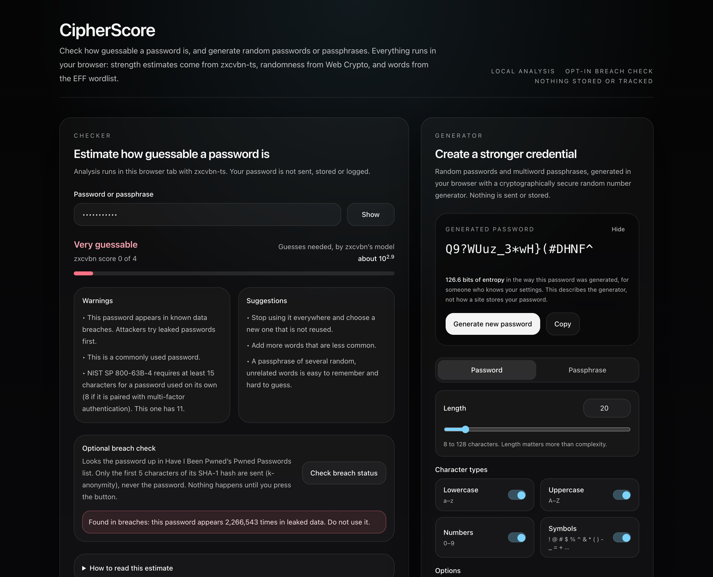
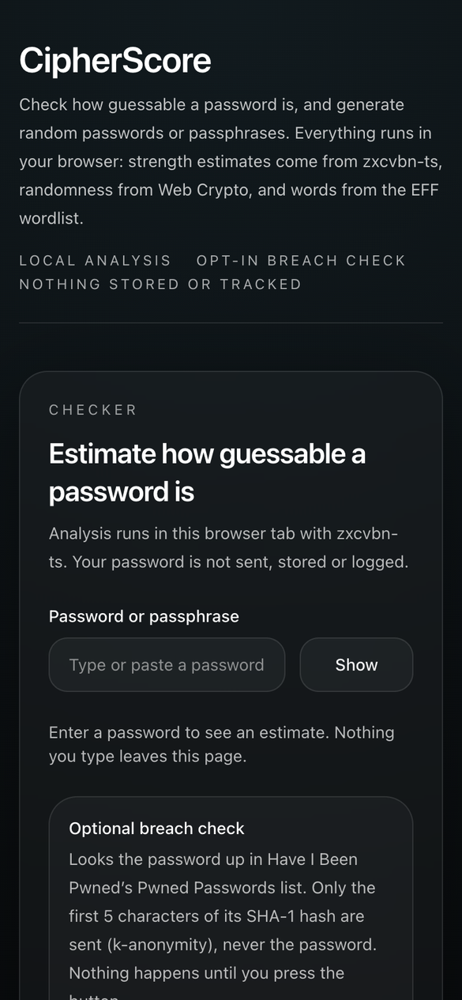

# CipherScore

CipherScore is a password checker and generator that runs in the browser. It estimates how guessable a password is with [zxcvbn-ts](https://github.com/zxcvbn-ts/zxcvbn), generates random passwords and multiword passphrases with the browser's cryptographically secure random number generator, and offers an opt-in check against Have I Been Pwned's breached-password list that sends only a 5-character hash prefix. There are no accounts, no database, no analytics and no password storage.

It is meant for one person checking or creating a password on their own device. It is not a password manager, it does not store anything, and it has not had an independent security review.

## Screenshots





The desktop screenshot shows the checker after typing `password123` and pressing **Check breach status**; the count comes from the live Pwned Passwords API. Both screenshots were taken from a production build in headless Chrome.

## Features

**Checker**

- Local strength estimate from zxcvbn-ts: a 0 to 4 score, a plain label ("Very guessable" to "Very hard to guess"), the estimated number of guesses as a power of ten, and zxcvbn's warnings and suggestions.
- A reminder when a password is shorter than the 15 characters NIST SP 800-63B-4 sets for single-factor passwords.
- Show/hide toggle; paste is allowed. Input of any length is accepted; the first 100 characters are analyzed.
- Opt-in breach check (k-anonymity). Nothing is requested until the button is pressed; editing the password cancels a running check and discards its answer.

**Generator**

- Random passwords of 8 to 128 characters (default 20) from lowercase, uppercase, digits and symbols, each switchable, with "Avoid look-alike characters" (`O 0 I l 1 |`) and "Include every selected type" options.
- Passphrases of 4 to 12 words (default 6) from the 7,776-word [EFF Large Wordlist](https://www.eff.org/dice), with a separator choice, optional capitalization and an optional number from 0 to 99.
- The entropy of the generation process for the current settings.
- Copy to clipboard, with a fallback that reveals and selects the value when the browser blocks clipboard access; hide/show of the value.
- Invalid settings (length out of range, no character type) produce an accessible error and no output.

## How it works

```text
Browser                                                      Server (Next.js route)
───────                                                      ──────────────────────
Checker input ──► lib/strength.ts (zxcvbn-ts, lazy-loaded)
                     └─► score, guesses, feedback (no password in the result)

Check breach  ──► lib/breach.ts
                     SHA-1(password) = PREFIX(5) + SUFFIX(35)
                     GET /api/breach-check?prefix=PREFIX ───────► app/api/breach-check/route.ts
                                                                   validates PREFIX, fetches
                                                                   api.pwnedpasswords.com/range/PREFIX
                     SUFFIX compared locally ◄── list of suffixes ◄ validates the rows, 512 KB cap

Generator     ──► lib/password-generator.ts
                     validate settings ─► lib/secure-random.ts randomInt()
                                             crypto.getRandomValues + rejection sampling
                     lib/entropy.ts: exact entropy of the settings
```

- **One source of randomness.** `randomInt` in `lib/secure-random.ts` is the only code that touches `crypto.getRandomValues`. It rejects draws that would cause modulo bias, and it throws if Web Crypto is unavailable instead of falling back to `Math.random`.
- **Uniform passwords with required types.** With "Include every selected type" on, whole passwords are redrawn until every selected type appears. That keeps every valid password equally likely; placing one character of each type first and shuffling would not.
- **State that cannot disagree with itself.** In the generator, a setting change and the value generated from it are applied in the same event handler, so the page never shows an old password beside new settings. The checker resets a breach verdict in the same event as the edit, and a copy confirmation is tied to the exact value that was copied.
- **Why a server route for the breach check.** The browser only ever talks to its own origin, which lets the Content-Security-Policy block requests to every other host. The route accepts nothing but a valid 5-character prefix, forwards no cookies or headers, times out after 8 seconds, logs nothing, and rejects answers that are not in the range format (otherwise an error page would read as "not breached").

## Security and privacy

### Threat model

CipherScore tries to protect a password from being sent, stored, logged or exposed by the app itself, and to give estimates that are not misleading. It cannot protect against a compromised device, malicious browser extensions, someone watching the screen, or a host that records the breach-check prefix together with your IP address.

### Implemented vs. verified

"Automated" means a test in `tests/` (`npm test`). "Browser" means a manual check of a production build in Chromium (an embedded browser and headless Chrome). Statistical tests and source scans can show that a bug is absent from what they exercise; they are not proofs.

| Property | Implementation | Verified | Not verified |
|---|---|---|---|
| Secure randomness | `randomInt` uses `crypto.getRandomValues`, fails closed without Web Crypto. | Automated: the Web Crypto call is observed; `Math.random` is rigged to throw and never reached; generation refuses to run without `crypto`; a source scan finds `getRandomValues` in exactly one module. During development, deliberately injected bugs (plain modulo, `Math.random`, a silent fallback) each made the suite fail. | The quality of the browser/OS CSPRNG is assumed. |
| No selection bias | Rejection sampling; whole-password redraw for required types. | Automated: exact accept/reject boundaries for 16 range sizes; chi-square tests on characters, words and positions. | Uniformity is tested statistically, not proven. |
| Output matches settings | Settings are validated before any randomness is used. | Automated: exact length for every length from 8 to 128; only allowed characters for all type and option combinations; boundaries 7, 8, 128 and 129 in the interface; a burst of rapid setting changes. | |
| Wordlist integrity | EFF list stored as an array. | Automated: 7,776 unique words; the original file is rebuilt from the array and its SHA-256 matches the downloaded file (`addd3553...b903e`). | That the downloaded file equals what EFF currently publishes. |
| Password not sent | The only password-related request is the opt-in breach check, which sends the 5-character prefix. | Automated: `fetch`, `XMLHttpRequest` and `sendBeacon` are watched while typing, generating and copying; the breach check sends exactly `?prefix=XXXXX`; neither the password nor the hash suffix appears in anything sent. Browser: the network log of a session shows one API request, `prefix=CBFDA`. | Browser extensions or a compromised device. |
| Breach answers handled safely | Prefix validated on both ends; rows validated; 512 KB cap; padding rows ignored. | Automated: malformed, oversized, failed, unreachable and slow answers; stale answers after an edit. Browser: seven live prefixes (80 to 110 KB, about 2,000 to 2,700 rows each) all pass validation. | Behaviour behind proxies or CDNs in a real deployment. |
| Not stored | No storage API is used. | Automated: storage, cookie and URL changes are watched; a source scan forbids storage APIs. Browser: storage, cookies and IndexedDB empty after use. | Browser memory, swap, crash dumps, and the clipboard. |
| Not logged | No `console` calls; the route logs nothing. | Automated: console spied on in component and route tests; a source scan forbids `console.`. Browser: the console was empty. | Host, proxy or CDN logs (they typically record the request URL, i.e. the prefix, and the client IP). |
| Egress restricted | CSP with `connect-src 'self'`, `frame-ancestors 'none'`, `Referrer-Policy: no-referrer` and more. | Automated: header contents. Browser: `fetch`, WebSocket and image requests to another origin were blocked by the CSP. | `script-src` still allows `'unsafe-inline'` (see Limitations). |
| Accessible | Native controls, labels, `role="alert"` errors, `role="status"` announcements, visible focus rings. | Browser: logical Tab order through every control; visible 2 px focus ring; Space toggles switches; arrow keys switch Password/Passphrase; no horizontal scroll at 375 to 390 px; text contrast at least 7.28:1 (custom script). Automated: roles, names, `aria-invalid`, alerts and announcements. | No screen reader, no axe/Lighthouse audit. |
| Copy | `navigator.clipboard.writeText` with a select-for-manual-copy fallback. | Automated: success, failure, missing API, and a late success after the value changed. Browser: the failure path. | **The success path in a real browser** (the test browsers deny clipboard access). |

### Limitations

- **Estimates are estimates.** zxcvbn models common passwords, words and patterns, not every attacker. For example, it rates the famous XKCD example `Tr0ub4dor&3` at about 10^11 guesses (score 4) because it does not know the comic. Only the first 100 characters are analyzed, and a high score says nothing about how a site stores the password.
- **The breach check reveals a little.** The 5-character prefix and your IP address reach whoever hosts the app and then Have I Been Pwned. Padding and k-anonymity limit what that reveals; they do not make it zero. "Not found" does not mean "strong".
- **No rate limiting.** The breach route forwards every valid request to Have I Been Pwned. A public deployment should add rate limiting at the platform level.
- **Main-thread pauses.** A pathological 100-character input can take about half a second to analyze. Moving zxcvbn into a Web Worker would remove that.
- **CSP keeps `'unsafe-inline'` for scripts**, because Next.js emits inline bootstrap scripts and a nonce-based policy would force dynamic rendering. HSTS and TLS are the deployment's job.
- **Dependency advisories.** `npm audit --omit=dev` reports 0 vulnerabilities. The full `npm audit` reports 3 moderate findings from one advisory (GHSA-rj75-hqrm-r3gf) in Tailwind CSS 3's build-time dependency chain; npm's only fix is a Tailwind 4 migration, which was not done. These packages run on the build machine, not in the served app. Re-run `npm audit` before deploying: advisory data changes daily.
- **Passphrase separators.** With the hyphen separator, a few hyphenated EFF words ("drop-down", "t-shirt") can make two different word sequences print identically. The effect on entropy is negligible and is not modelled.
- **Not tested:** Safari, Firefox, real mobile devices, screen readers, and any public deployment. There has been no independent security review or penetration test.

## Running it

Requires Node.js 20.9 or newer (developed and tested on 20.20.2).

```bash
npm install
npm run dev          # development server on http://localhost:3000
```

```bash
npm test             # Vitest: 269 tests in 11 files, about 10 s
npm run typecheck    # TypeScript (strict)
npm run build        # production build
npm start            # serve the production build
```

There is no linter configured; TypeScript runs in strict mode.

### What the tests cover

| File | Covers |
|---|---|
| `secure-random.test.ts` | `getRandomValues` usage, no `Math.random`, fail-closed behaviour, input validation, rejection boundaries, chi-square uniformity |
| `entropy.test.ts` | log2 helper; inclusion-exclusion counts against brute force |
| `password-generator.test.ts` | length, allowed characters, required types, distribution, configuration edge cases |
| `passphrase.test.ts` | construction, separators, validation, entropy, wordlist integrity (SHA-256) |
| `strength.test.ts` | scores for weak and strong inputs, truncation, responsiveness, no password data in the result |
| `breach.test.ts`, `breach-route.test.ts` | SHA-1 vectors, range parsing, prefix-only requests, error handling, prefix and row validation, size cap, no logging |
| `password-generator.component.test.tsx`, `password-checker.component.test.tsx`, `password-checker.load-failure.component.test.tsx` | The real components in jsdom: behaviour, accessible errors, clipboard outcomes, slow and stale breach answers, estimator load failure and retry, privacy probes, and checks that the screen never shows a value that disagrees with the settings, read after React's synchronous work and before the next task |
| `privacy-static.test.ts` | Source tripwires (forbidden APIs, trackers, where `fetch` and `getRandomValues` may appear, the dependency list) and security-header checks |

## Project structure

```text
app/
  api/breach-check/route.ts   prefix-only proxy to the Pwned Passwords range API
  page.tsx, layout.tsx, globals.css, icon.svg
components/
  password-checker.tsx        checker UI, breach check
  password-generator.tsx      generator UI, copy
  section-shell.tsx
lib/
  secure-random.ts            the only module that calls the randomness API
  password-generator.ts       passwords, passphrases, validation, entropy
  entropy.ts                  exact entropy (inclusion-exclusion)
  strength.ts                 zxcvbn-ts wrapper
  breach.ts                   SHA-1, range parsing, lookup
  guidance.ts                 NIST length guidance
  wordlists/eff-large.ts      EFF Large Wordlist
tests/                        Vitest suites and helpers
next.config.mjs               Content-Security-Policy and security headers
```

**Stack:** Next.js 16 (App Router, Turbopack), React 19, TypeScript, Tailwind CSS 3, Vitest 4 with jsdom and Testing Library. Runtime dependencies are Next, React and the three `@zxcvbn-ts` packages.

## AI assistance

AI tools were used during development, debugging, and testing. Project requirements, design decisions, and validation were directed by the developer.

## Third-party material

Full notices are in [THIRD_PARTY_NOTICES.md](./THIRD_PARTY_NOTICES.md).

- **EFF Large Wordlist for Passphrases**, Electronic Frontier Foundation, licensed [CC BY 3.0 US](https://creativecommons.org/licenses/by/3.0/us/), from <https://www.eff.org/dice>. Stored unmodified (dice numbers removed) in `lib/wordlists/eff-large.ts`; attributed in the app footer.
- **zxcvbn-ts** (`@zxcvbn-ts/core`, `language-common`, `language-en`), MIT License.
- **Have I Been Pwned: Pwned Passwords** by Troy Hunt, used through its public range API.

## License

The code is released under the [MIT License](./LICENSE). The EFF Large Wordlist in `lib/wordlists/eff-large.ts` is not covered by that license: it remains © Electronic Frontier Foundation under [CC BY 3.0 US](https://creativecommons.org/licenses/by/3.0/us/), and any reuse must keep its attribution (see [THIRD_PARTY_NOTICES.md](./THIRD_PARTY_NOTICES.md)).
